# Predicting Self-Rated Health from the BRFSS 2021 Survey

**Author:** Marius Botezatu  
**Date:** 7 November 2026  
**Code:** `brfss.py` — <https://github.com/botezatumarius/brfss-health-classification>

## 1. Introduction

The Behavioral Risk Factor Surveillance System (BRFSS) is the largest continuous health survey in the
world: every year it interviews more than 400,000 adults in the United States about their health,
habits and living conditions. One of its first questions is simple: *"Would you say that in general your
health is excellent, very good, good, fair or poor?"* (`GENHLTH`). This self-rating is one of the best
single predictors of future illness and mortality, so understanding what drives it is useful for
public health.

**Goal.** Predict whether a person rates their health as **fair or poor** from information about their
chronic conditions, disabilities, lifestyle, use of health care and socioeconomic situation, and find
which of these factors matter most.

**Approach in brief.** The five answers are grouped into a binary problem: *Fair/Poor* (16.6 % of people)
against *Excellent/Very good/Good*. The data is cleaned with the official codebook, leaking variables are
removed, and ten classifiers are compared with the same stratified 10-fold cross-validation. The
analysis then studies class imbalance, dimensionality reduction, feature selection, statistical
significance, errors and explanations (SHAP), and finally tunes the best model with nested
cross-validation, adds clinically motivated features, solves the three-class version of the problem,
and confirms the result on 100,000 people never used before.

| Level of the guidelines | Where |
|---|---|
| Basic: cleaning, EDA, dummy baseline, feature selection, 2 tuned models, 10-fold CV | Sections 2–5 |
| Intermediate: 10 models, imbalance, PCA, advanced selection + hypothesis, Wilcoxon, errors, SHAP | Section 6 |
| Advanced: nested CV with automatic search, LightGBM, three classes, feature engineering | Section 7 |
| Final model, recommendation and conclusions | Sections 8–9 |
| Ethics | Section 10 |

## 2. Data and preprocessing

### 2.1 The dataset

The 2021 BRFSS file has **438,693 interviews and 303 columns**. Each column is a survey answer or a
variable computed by the CDC, and every code is documented in the codebook. Three problems stand out:

- **Special codes instead of empty cells.** "Don't know", "Refused" and "Not asked" are stored as numbers
  (7/9, 77/99, 777/999…), and some numbers have other meanings: in `PHYSHLTH`, 88 means "zero days".
  Used as they are, a model would read "refused" as "a lot".
- **Many columns are mostly empty.** Optional modules are asked only in some states: once the special
  codes are treated as missing, **160 of the 303 columns are more than 50 % empty** (Figure 1).
- **Administrative columns.** Interview dates, phone-screening questions, survey weights and record IDs
  describe the interview, not the person.

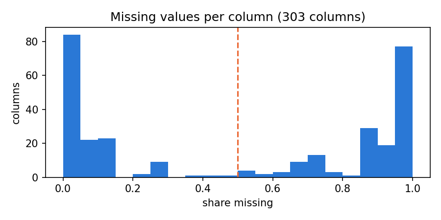

*Figure 1: share of missing values per column, after the codebook's "don't know / refused / not asked"
codes are converted to missing. The dashed line marks 50 %.*

The target has five classes, and 1,161 interviews with "don't know", "refused" or no answer were removed,
leaving **437,532 people**.

### 2.2 Leakage: variables that already contain the answer

The guidelines warn that some variables are directly related to the target. To find them objectively,
every column was used *alone* to predict the target and its ROC-AUC was measured (Figure 2):

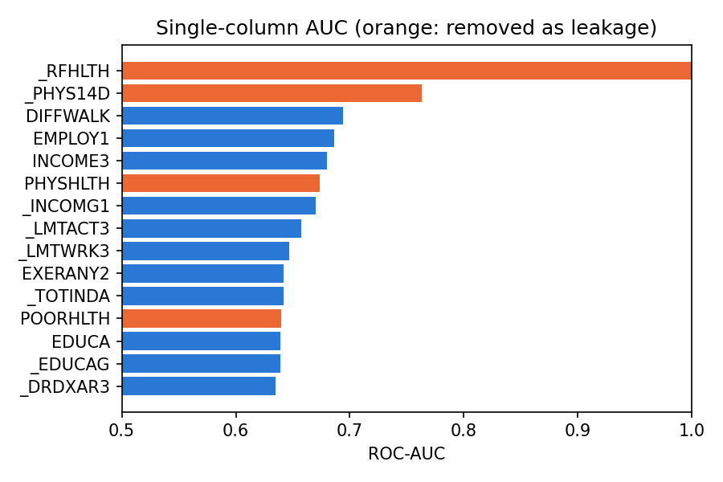

*Figure 2: ROC-AUC of each column on its own (top 15). Orange columns were removed.*

- **`_RFHLTH`** reaches an AUC of exactly **1.000**: the codebook confirms it is *computed from* `GENHLTH`
  ("adults with good or better health"). It is the target itself.
- **`PHYSHLTH`, `MENTHLTH`, `POORHLTH`** ("days of poor physical/mental health") and their derived
  versions **`_PHYS14D`, `_MENT14D`** belong to the CDC's *Healthy Days* measure (HRQOL-4), which asks
  the same self-assessment as `GENHLTH` in another form. `_PHYS14D` alone reaches 0.763, more than any
  real risk factor.

All six were removed: the aim is to predict self-rated health from *causes and circumstances*, not from
another version of the same self-rating.

### 2.3 Selected variables

From the columns that are less than half empty, after dropping administrative and leaking ones, **49
variables** were kept in seven meaningful groups. When the CDC provides a cleaned "calculated" version of
an answer (for example `_BMI5` instead of raw weight and height, or `_SMOKER3` instead of three smoking
questions) only that version is kept, to avoid near-duplicate columns.

| Group | Variables (examples) | Count |
|---|---|---|
| Demographics | age, sex, race/ethnicity, marital status, state, rural county | 8 |
| Socioeconomic | income, education, employment, home ownership | 4 |
| Health care | insurance, personal doctor, could not afford a doctor, last checkup | 4 |
| Chronic conditions | blood pressure, cholesterol, heart disease, stroke, COPD, diabetes, depression, kidney disease, cancer, asthma, arthritis | 12 |
| Disability | difficulty walking, dressing, doing errands, concentrating; deaf; blind; arthritis limits activities | 7 |
| Lifestyle | physical activity, smoking, e-cigarettes, alcohol, fruit, vegetables, fried potatoes, BMI | 10 |
| Prevention | flu shot, pneumonia vaccine, HIV test, cholesterol check | 4 |

The most incomplete selected variable is income (21.5 % missing); all the others are under 15 %.

### 2.4 Cleaning and encoding

`encode()` in `brfss.py` applies one rule per variable, taken from the codebook:

| Type | Count | Treatment | Example |
|---|---|---|---|
| Numeric | 6 | special codes → missing; implied decimals removed | `_BMI5` = 2735 → BMI 27.35 |
| Binary | 27 | yes → 1, no → 0, don't know/refused → missing | `DIFFWALK` |
| Ordinal | 8 | ordered ranks (label encoding) | income 1–7; smoking: never 0 → every day 3 |
| Nominal | 8 | one-hot encoding, with "missing" as its own category | employment, marital status, state |

Missing values are imputed **inside each training fold** (median for numeric, binary and ordinal
variables, plus a 0/1 "was missing" indicator; a separate category for nominal ones), and numeric
columns are standardised. Doing this inside the cross-validation pipeline means no information from a
test fold is ever used for training. After encoding, each person is described by **175 columns**.

## 3. Exploratory data analysis

### 3.1 The target is imbalanced

| GENHLTH | Excellent | Very good | Good | Fair | Poor |
|---|---|---|---|---|---|
| People | 77,741 | 149,112 | 137,938 | 54,736 | 18,005 |
| Share | 17.8 % | 34.1 % | 31.5 % | 12.5 % | 4.1 % |

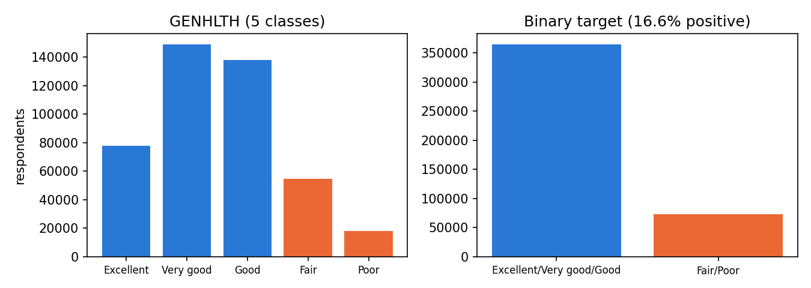

*Figure 3: the five classes and the binary target used in this work.*

The binary positive class (*Fair/Poor*) is **16.6 %** of the people: about **1 in 6**. A model that
always answers "good health" would be right 83.4 % of the time while being useless, which is why
**accuracy is not used**: the main metric is **ROC-AUC** (the probability that a random Fair/Poor person
gets a higher score than a random healthy one), as the guidelines require, completed by the precision-
recall AUC, balanced accuracy and F1, which focus on the minority class.

### 3.2 What the raw data already shows

| Characteristic | Share in Fair/Poor health |
|---|---|
| Difficulty walking: yes / no | 51.7 % / 9.9 % |
| COPD: yes / no | 48.7 % / 13.8 % |
| Depression: yes / no | 30.2 % / 13.2 % |
| Physically inactive / active | 32.7 % / 11.4 % |
| Smoking: never / former / some days / every day | 12.6 / 20.1 / 25.0 / 28.8 % |
| Education: no high school → college graduate | 38.4 % → 9.4 % |
| Income: < $15k → > $200k | 43.0 % → 4.0 % |

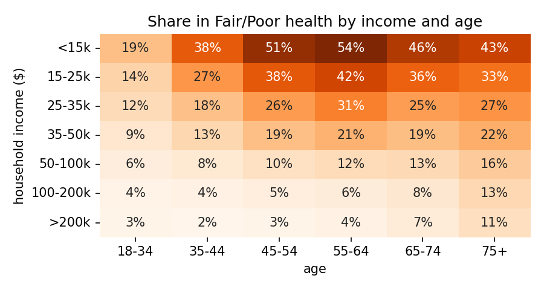

*Figure 4: share of people in Fair/Poor health by household income and age.*

Figure 4 is the clearest pattern in the data: **income matters more than age**. Among people aged 55–64,
54 % of those earning under $15,000 report fair or poor health, against 4 % of those earning over
$200,000. Age matters differently by income: in low-income groups poor health peaks at 55–64 and then
falls (possibly because the sickest die earlier), while in high-income groups it rises steadily with age.

The selected variables are only weakly correlated with each other (Figure 5): of 820 pairs, only one
exceeds 0.5 (binge drinking with drinks per week, 0.53), followed by natural pairs such as age with
pneumonia vaccination (0.48), the disability questions with each other (≈ 0.4) and education with income
(0.43). No variable had to be removed for redundancy.

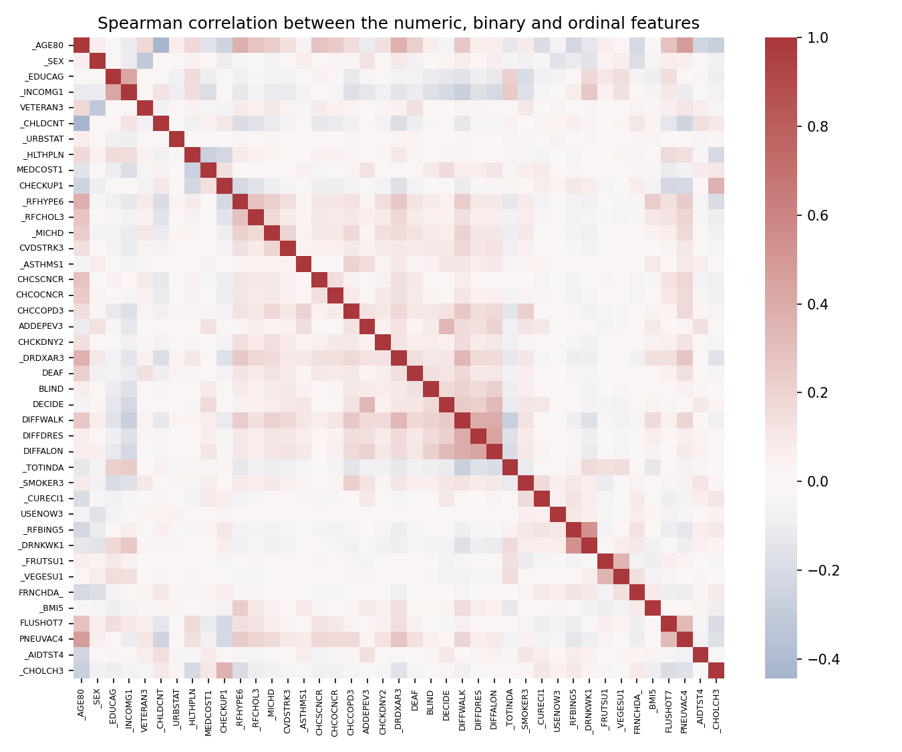

*Figure 5: Spearman correlation between the numeric, binary and ordinal variables.*

## 4. Methodology

### 4.1 One validation protocol for every experiment

- **Stratified 10-fold cross-validation** for every experiment, as required, with **the same ten folds
  everywhere** (`StratifiedKFold(10, shuffle=True, random_state=42)`, defined once in `brfss.py`). Each
  model is therefore tested on exactly the same people, which is what makes the Wilcoxon tests of
  Section 6.5 valid.
- Every preprocessing step (imputation, scaling, encoding, feature selection, PCA, resampling) is part of
  a `Pipeline` fitted on the training folds only.
- Results are stored **per fold** (`results/*.csv`), and are reported as mean ± standard deviation.

### 4.2 How much data is needed?

Ten-fold cross-validation of ten models on 437,532 people would take days. A **learning curve** shows
how much data the models really need (Figure 6): models were trained on growing samples and tested on
the same 50,000 unseen people.

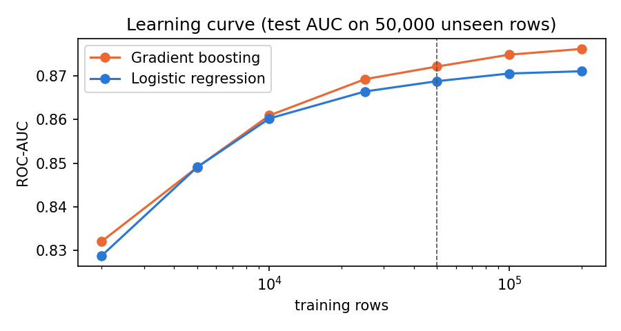

*Figure 6: test ROC-AUC against the number of training rows (log scale). The dashed line marks 50,000.*

| Training rows | 10,000 | 25,000 | **50,000** | 100,000 | 200,000 |
|---|---|---|---|---|---|
| Logistic regression | 0.860 | 0.866 | **0.869** | 0.871 | 0.871 |
| Gradient boosting | 0.861 | 0.869 | **0.872** | 0.875 | 0.876 |

Beyond 50,000 rows, four times more data adds at most 0.004 AUC. The experiments therefore use a
**stratified sample of 50,000 people**, and a separate **hold-out set of 100,000 people** is kept untouched
until the very end (Section 8) to confirm the final model on data never used for any decision.

## 5. Basic level

### 5.1 Baseline

A `DummyClassifier` that ignores the features scores **ROC-AUC = 0.500 ± 0.000** (always predicting the
class proportions) and 0.500 ± 0.007 (random guesses with those proportions). Any useful model must be
clearly above 0.5.

### 5.2 Basic feature selection

With 175 encoded columns, a filter method keeps the columns most related to the target. The ANOVA F-test
(`SelectKBest(f_classif)`, fitted inside each fold) ranks the columns and a logistic regression is
trained on the best *k*:

| Columns kept (k) | 5 | 10 | 20 | **40** | 80 | all (175) |
|---|---|---|---|---|---|---|
| ROC-AUC | 0.755 | 0.832 | 0.850 | **0.859** | 0.860 | 0.860 |

Forty columns, less than a quarter, already give almost the full performance; beyond them the gain is
0.001. The two models of this section are tuned on these 40 columns.

### 5.3 Two models tuned by hand

**Logistic regression** — regularisation strength *C* (smaller *C* = simpler model):

| C | 0.001 | 0.01 | **0.1** | 1 | 10 |
|---|---|---|---|---|---|
| ROC-AUC | 0.8575 | 0.8590 | **0.8592** | 0.8592 | 0.8592 |

Strong regularisation hurts slightly; from *C* = 0.1 the model no longer changes, so 0.1 is kept.

**Decision tree** — depth and minimum number of people per leaf:

| max_depth | 3 | 5 | 8 | 12 | none | 8 | 12 | 12 | **16** | 16 | 20 |
|---|---|---|---|---|---|---|---|---|---|---|---|
| min_samples_leaf | 1 | 1 | 1 | 1 | 1 | 100 | 100 | 400 | **100** | 200 | 200 |
| ROC-AUC | 0.746 | 0.786 | 0.810 | 0.744 | 0.653 | 0.821 | 0.835 | 0.832 | **0.840** | 0.840 | 0.839 |

The tuning shows the classic trade-off. A shallow tree underfits (0.746); an unlimited tree memorises the
training folds and collapses (0.653). Requiring at least 100 people per leaf stops this overfitting and
lets the tree grow deeper usefully: depth 16 with 100 per leaf is the best setting (0.840).

Both tuned models are far above the baseline, and the linear model beats the tree (0.859 against
0.840): many effects in this data are roughly additive (each condition adds risk), which suits a linear
model.

## 6. Intermediate level

### 6.1 Ten classifiers on the same folds

Ten classifiers of different families were trained on all 49 variables (175 encoded columns), with the
tuned settings of Section 5 or standard settings:

| Model | ROC-AUC | PR-AUC | Balanced acc. | F1 | Fit time / fold |
|---|---|---|---|---|---|
| **Gradient boosting (scikit-learn)** | **0.8663 ± 0.0045** | 0.595 | 0.685 | 0.509 | 193 s |
| **Hist. gradient boosting** | **0.8662 ± 0.0039** | 0.595 | 0.689 | 0.517 | 12 s |
| **LightGBM** | **0.8662 ± 0.0051** | 0.595 | 0.693 | 0.523 | 6 s |
| Random forest | 0.8636 ± 0.0054 | 0.590 | 0.631 | 0.407 | 50 s |
| Extra trees | 0.8611 ± 0.0058 | 0.589 | 0.636 | 0.417 | 106 s |
| Logistic regression | 0.8604 ± 0.0049 | 0.593 | 0.675 | 0.493 | 2 s |
| Neural network (MLP 64-32) | 0.8603 ± 0.0046 | 0.587 | 0.696 | 0.525 | 9 s |
| Decision tree | 0.8395 ± 0.0051 | 0.543 | 0.663 | 0.465 | 3 s |
| k-nearest neighbours (k = 150) | 0.8354 ± 0.0031 | 0.538 | 0.563 | 0.228 | 1 s |
| Gaussian naive Bayes | 0.8057 ± 0.0057 | 0.446 | 0.736 | 0.512 | 1 s |

*Balanced accuracy and F1 use the default threshold of 0.5; PR-AUC baseline (random model) = 0.166.*

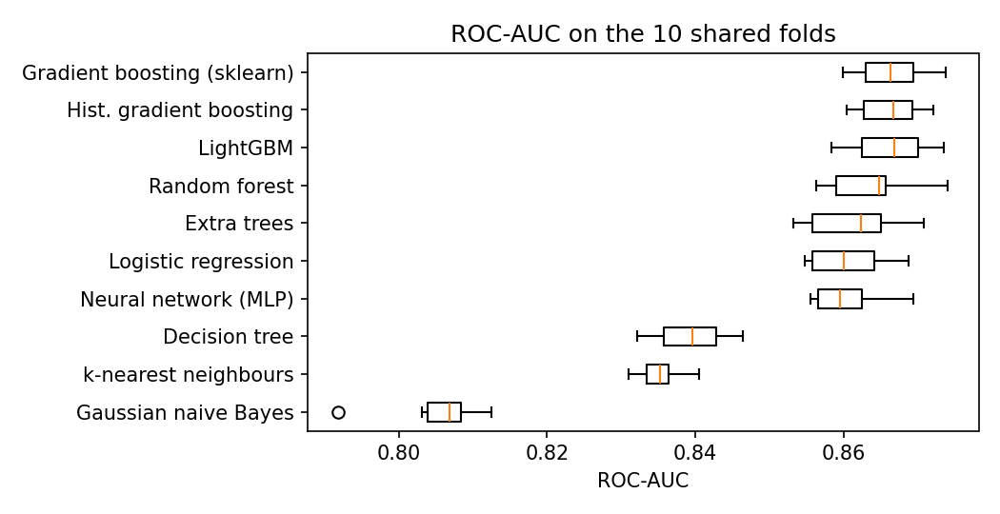

*Figure 7: ROC-AUC of each model on the ten shared folds.*

**Findings.**

- **Gradient boosting wins**, and its three implementations are practically tied (0.8662–0.8663).
  LightGBM reaches the same AUC **30 times faster** than scikit-learn's `GradientBoostingClassifier`,
  which makes it the natural model to tune (Section 7).
- **The simple logistic regression is only 0.006 behind.** The relationship is mostly additive (each
  condition adds risk), and the boosted trees gain by capturing a few non-linear effects and
  interactions, such as the U-shaped effect of BMI (Section 6.7).
- **Bagging is weaker than boosting**: random forest and extra trees improve on a single tree (0.840 →
  0.864) by averaging, but boosting corrects the errors of previous trees and gets further.
- **k-NN and naive Bayes are the weakest**: k-NN suffers from the 175 dimensions (distances become less
  informative), and naive Bayes assumes the variables are independent, which they are not.
- **Threshold metrics tell a different story.** Naive Bayes has the *worst* AUC but the *best* balanced
  accuracy, because its probabilities are poorly calibrated and, at the default threshold of 0.5, it
  predicts "Fair/Poor" much more often. This is why ROC-AUC, which does not depend on a threshold, is the
  main metric, and why the threshold of the final model is chosen explicitly (Section 8).

### 6.2 Class imbalance

Only 1 person in 6 is in the positive class. Four standard remedies were applied **inside the training
folds only** (the test folds keep the real proportions), to the best linear and the best boosted model:

| Technique | LR: ROC-AUC | LR: Bal. acc. | LR: F1 | LightGBM: ROC-AUC | LightGBM: Bal. acc. | LightGBM: F1 |
|---|---|---|---|---|---|---|
| None | 0.8604 | 0.675 | 0.493 | **0.8662** | 0.693 | 0.523 |
| Class weights (`balanced`) | **0.8613** | **0.781** | **0.562** | 0.8654 | **0.782** | 0.562 |
| Random undersampling | 0.8603 | 0.780 | 0.558 | 0.8625 | 0.782 | 0.544 |
| Random oversampling | 0.8610 | 0.780 | 0.561 | 0.8653 | 0.782 | **0.565** |
| SMOTE | 0.8567 | 0.778 | 0.554 | 0.8656 | 0.691 | 0.519 |

**Findings.**

- **Rebalancing does not improve the ranking (ROC-AUC changes by less than 0.004)**, but it moves the
  threshold: balanced accuracy jumps from 0.68–0.69 to 0.78, and F1 from 0.49–0.52 to 0.56. Giving the
  minority class more weight makes the model predict *Fair/Poor* more often, so it finds many more of
  those people at the price of more false alarms.
- **The same effect can be obtained by simply lowering the threshold** of the unbalanced model, which is
  what the final model does (Section 8). Since AUC is unchanged, class weights are only a different way
  of choosing that threshold, not a better model.
- **Undersampling** throws away 70 % of the healthy people, which costs LightGBM 0.004 AUC.
- **SMOTE is the worst option here.** It creates synthetic people by interpolating between neighbours,
  which produces impossible values for one-hot and yes/no columns (e.g. "0.37 married"). The logistic
  regression loses 0.004 AUC; LightGBM learns that fractional values mean "synthetic positive", so the
  synthetic points teach it nothing about real people and its balanced accuracy stays at the unbalanced
  level (0.691).

### 6.3 Dimensionality reduction with PCA

PCA replaces the 175 encoded columns with a few uncorrelated combinations of them. It was fitted inside
each training fold, before the classifier.

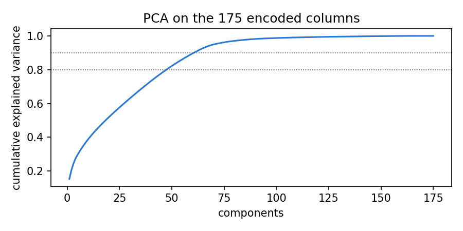

*Figure 8: cumulative variance explained by the principal components.*

| Components | 5 | 10 | 20 | 40 | 80 | none (175 columns) |
|---|---|---|---|---|---|---|
| Variance explained | 30 % | 39 % | 52 % | 73 % | 97 % | 100 % |
| Logistic regression | 0.847 | 0.848 | 0.851 | 0.853 | 0.860 | **0.860** |
| LightGBM | 0.843 | 0.845 | 0.850 | 0.852 | 0.859 | **0.866** |

**Findings.** The variance is spread over many directions (48 components are needed for 80 %), because
the variables are weakly correlated (Section 3.2). PCA never helps: with 80 components it matches the
logistic regression, but it costs LightGBM 0.008 AUC. Two reasons: PCA keeps the directions with the
most *variance*, not the ones that best separate the classes, and its components mix all variables
together, which destroys the simple splits that trees exploit (such as "has difficulty walking"). It
also makes the model impossible to explain. **PCA is therefore not used.**

### 6.4 Advanced feature selection and a hypothesis

**Four selection methods.** Each method keeps the 20 best of the 175 encoded columns, is fitted inside
the training folds, and the same LightGBM is trained on the result:

| Method | Type | How it ranks columns | ROC-AUC |
|---|---|---|---|
| L1 logistic regression | embedded | the L1 penalty drives useless coefficients to zero | **0.855** |
| ANOVA F-test | filter | each column alone (difference of means) | 0.850 |
| LightGBM importance | embedded | number of splits on the column | 0.836 |
| RFE with logistic regression | wrapper | repeatedly drops the smallest coefficients | 0.825 |
| *All 175 columns* | — | — | ***0.866*** |

- The **L1 penalty** is the best selector because it looks at all columns *together*: of two correlated
  columns it keeps one, while the ANOVA filter, which judges columns one by one, keeps both.
- **LightGBM's importance is biased** towards continuous variables (age, BMI, fruit, vegetables), which
  offer many possible split points, and it discards strong yes/no variables such as COPD.
- **RFE** ranks columns by coefficient size; rare categories (a single state, a rare employment status)
  get large but unreliable coefficients, so RFE keeps them and loses useful ones.
- **No selection beats using all columns** (L1 top 20 loses 0.011, significant in Section 6.5). The models
  cope well with 175 columns and 50,000 people, so selection is useful for simplicity, not accuracy.

The variables chosen by all four methods were education, heart disease, arthritis limiting activity and
physical inactivity; three of four also chose difficulty walking or doing errands, COPD, depression,
diabetes, high blood pressure, income and employment.

**Hypothesis.** *Self-rated health is mainly determined by physical function (disability), chronic
disease and socioeconomic status; demographics, lifestyle, health care use and prevention add little once
these are known.* Each group was tested alone, then the three hypothesis groups together (23 of the 49
variables):

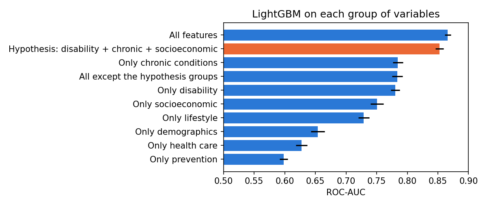

*Figure 9: ROC-AUC of LightGBM trained on each group of variables, on the same folds.*

| Variables used | Count | ROC-AUC |
|---|---|---|
| Prevention only | 4 | 0.598 |
| Health care only | 4 | 0.627 |
| Demographics only | 8 | 0.654 |
| Lifestyle only | 10 | 0.729 |
| Socioeconomic only | 4 | 0.751 |
| Disability only | 7 | 0.780 |
| Chronic conditions only | 12 | 0.785 |
| All *except* the hypothesis groups | 26 | 0.784 |
| **Hypothesis: disability + chronic + socioeconomic** | **23** | **0.853** |
| All variables | 49 | 0.866 |

**The hypothesis is largely confirmed, but not completely.** The three groups alone reach 0.853, which is
**96 % of the improvement over chance** obtained with all variables (0.353 of 0.366), with fewer than half
of them. The 26 other variables together reach only 0.784. Yet the remaining 0.013 is real (the
hypothesis set loses on all 10 folds, Section 6.5): the rest of the data, mostly physical activity, age
and BMI, still adds information that is not contained in diseases, disabilities and income.

### 6.5 Are the differences real? Statistical tests

Differences of 0.001 AUC could be luck. Because every model was tested on **the same ten folds**, the
models can be compared fold by fold, which removes the variation caused by the folds themselves.

1. **Friedman test** (are the ten models all equivalent?): χ² = 83.2, p = 4 × 10⁻¹⁴. They are not.
2. **Wilcoxon signed-rank test** for each pair of the five best models: a non-parametric test on the ten
   paired fold differences. With ten pairwise tests, some would be "significant" by chance, so the
   p-values are corrected with the **Holm** method.

| Model A | Model B | Mean difference | Folds A wins | p (Holm) | Significant |
|---|---|---|---|---|---|
| Gradient boosting (sklearn) | LightGBM | +0.0001 | 6 / 10 | 1.00 | no |
| LightGBM | Hist. gradient boosting | −0.0000 | 6 / 10 | 1.00 | no |
| Gradient boosting (sklearn) | Hist. gradient boosting | +0.0001 | 5 / 10 | 1.00 | no |
| LightGBM | Random forest | +0.0026 | 9 / 10 | 0.029 | **yes** |
| Gradient boosting (sklearn) | Random forest | +0.0027 | 9 / 10 | 0.023 | **yes** |
| Hist. gradient boosting | Random forest | +0.0026 | 9 / 10 | 0.055 | no (borderline) |
| any boosting model or random forest | Extra trees | +0.0025 to +0.0052 | 10 / 10 | 0.020 | **yes** |

The same test answers the questions of the other sections:

| Comparison | Mean difference | Folds won | p (Holm) | Conclusion |
|---|---|---|---|---|
| Hypothesis groups vs all variables | −0.0135 | 0 / 10 | 0.012 | all variables are better |
| L1 selection (top 20) vs all columns | −0.0112 | 0 / 10 | 0.012 | selection loses accuracy |
| LightGBM tuned (nested CV, Section 7.1) vs untuned | +0.0027 | 10 / 10 | 0.012 | tuning helps |
| Logistic regression tuned vs untuned | +0.0007 | 9 / 10 | 0.029 | tiny but consistent gain |
| Logistic regression + engineered features vs without | +0.0009 | 8 / 10 | 0.029 | small but real gain |
| LightGBM + engineered features vs without | −0.0004 | 3 / 10 | 0.43 | no effect |

**Conclusions.** The three gradient boosting implementations are statistically **indistinguishable**, so
the choice between them is made on speed: **LightGBM** (6 s per fold against 193 s). Boosting is
significantly better than bagging (random forest, extra trees).

*Caveat:* the ten training sets overlap, so the fold scores are not fully independent and the tests are
somewhat optimistic; with only ten folds, the smallest possible p-value is 0.002. Differences that win
on all ten folds are nevertheless very unlikely to be chance.

### 6.6 Error analysis: who does the model get wrong?

Every person in the sample received an **out-of-fold** prediction (from the model of the fold in which
they were in the test set) from the three best different models: LightGBM, histogram gradient boosting
and logistic regression. Each model's threshold was set to maximise sensitivity + specificity
(Youden's J). A person is *consistently misclassified* when **all three** models get them wrong:

| | Consistently misclassified | Share of their class |
|---|---|---|
| False negatives (Fair/Poor predicted as healthy) | 1,366 | 16 % of Fair/Poor |
| False positives (healthy predicted as Fair/Poor) | 7,186 | 17 % of healthy |

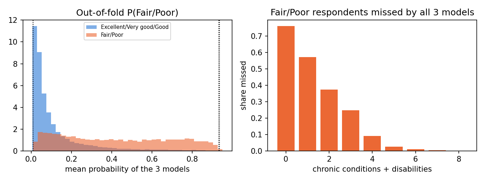

*Figure 10: left, out-of-fold probabilities of the two classes (dotted lines: the four cases below);
right, share of Fair/Poor people missed by all three models, by number of chronic conditions and
disabilities.*

**Four typical cases** — the two most confident errors of each kind:

| | #155681 (FN) | #80087 (FN) | #179027 (FP) | #87717 (FP) | Fair/Poor median | Healthy median |
|---|---|---|---|---|---|---|
| Self-rated health | Fair/Poor | Fair/Poor | Good or better | Good or better | | |
| Age, sex | 29, woman | 37, man | 62, man | 57, man | 62 | 56 |
| Income | $100–200k | not given | not given | < $15k | $25–35k | $50–100k |
| Education | college graduate | college graduate | no high school | high school | some college | some college |
| Employment | employed | self-employed | unable to work | unable to work | | |
| Chronic conditions / disabilities | 0 / 0 | 0 / 0 | 6 / 4 | 8 / 5 | 3 / 1 | 1 / 0 |
| Physically active, smoking | yes, never | yes, never | no, every day | no, every day | | |
| BMI | 20.9 | 25.8 | not given | 35.8 | 29.3 | 27.2 |
| P(Fair/Poor), mean of 3 models | **0.01** | **0.01** | **0.94** | **0.93** | | |

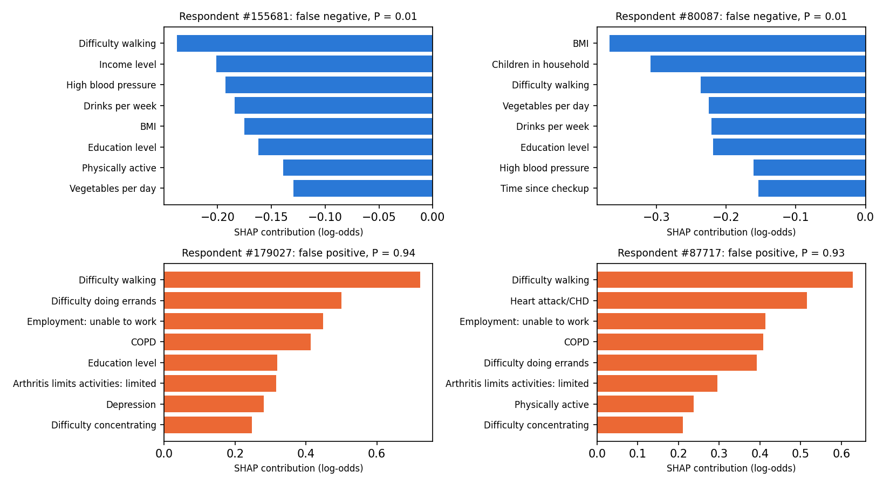

*Figure 11: SHAP contributions of the eight most important columns for each case, from the LightGBM
model of the fold in which the person was tested (blue lowers, orange raises the predicted risk).*

**What the errors have in common.**

- **The missed Fair/Poor people look healthy on every measured factor.** Compared with the Fair/Poor
  people the models do find, they have half as many chronic conditions (1.6 against 3.8), almost no
  disabilities (0.2 against 1.7; difficulty walking 3 % against 58 %), are more often active (83 % against
  47 %) and richer. Figure 10 (right) shows it clearly: 76 % of the Fair/Poor people with no condition
  and no disability are missed, against almost none of those with five or more. In Figure 11 every
  contribution of the two false negatives is negative: nothing in their answers points to poor health.
- **The false alarms carry a heavy burden but still rate their health as good.** The two cases have six
  and eight chronic conditions, four and five disabilities, cannot work and smoke every day; the model
  is right that their risk is very high.
- **These errors cannot be fixed with these variables.** The false negatives' poor health comes from
  something the survey variables do not record (an acute illness, pain, a recent injury, mental health
  beyond a depression diagnosis), and the false positives illustrate *adaptation*: people living with
  long-term conditions often judge their health against people like them, not against a healthy
  person. Self-rated health is a personal judgement, and the model can only estimate the risk.

### 6.7 Explaining the model with SHAP

SHAP (SHapley Additive exPlanations) splits each prediction into the contribution of every variable,
measured in log-odds: positive values push towards *Fair/Poor*. The values below are from LightGBM
trained on the 50,000 people, explained on 3,000 of them; the contributions of the one-hot columns
of a variable are added together.

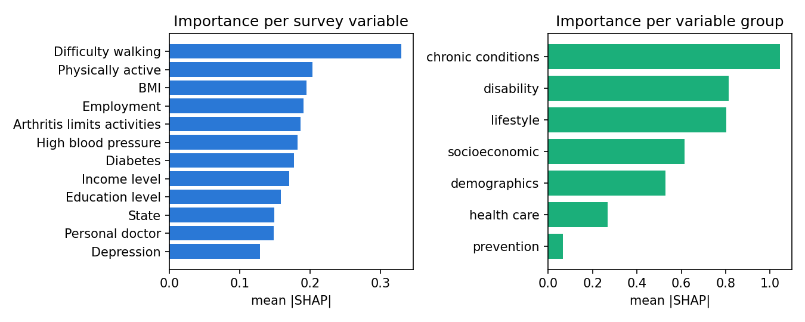

*Figure 12: mean absolute SHAP value per survey variable (left) and per group of variables (right).*

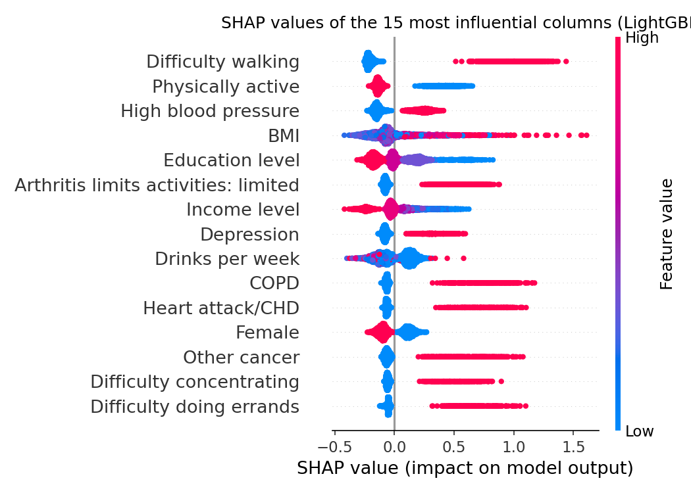

*Figure 13: each dot is one person; its position is the column's effect on that person's prediction and
its colour the value of the column (red = high / yes).*

- **Difficulty walking is by far the most important variable**, followed by physical activity, BMI,
  employment (mostly "unable to work"), arthritis limiting activity, high blood pressure, diabetes,
  income and education. The ranking matches the hypothesis of Section 6.4: function, chronic disease
  and socioeconomic position.
- **Directions agree with medical knowledge**: every disease and disability increases the risk;
  education, income and physical activity decrease it.
- **By group**, chronic conditions (12 variables) carry the most weight, then disability, lifestyle and
  socioeconomic status; prevention matters almost nothing.

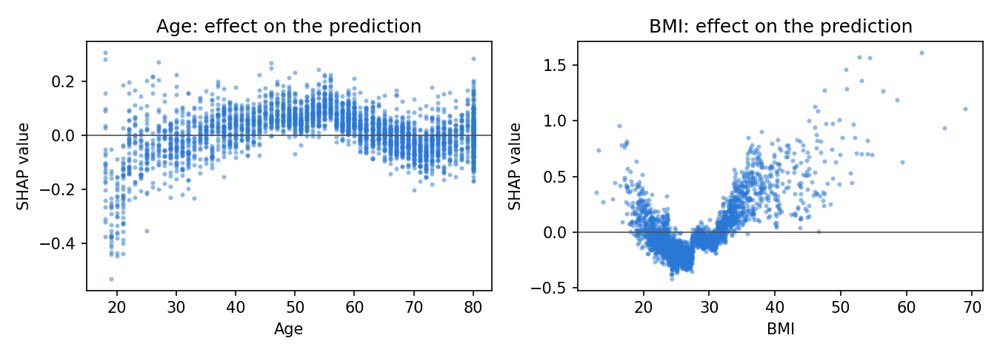

*Figure 14: effect of age and BMI on the prediction, for each person.*

Two effects that a linear model cannot represent explain why boosting beats logistic regression
(Section 6.1):

- **BMI has a U-shaped effect.** The risk is lowest around a BMI of 23–27, rises steeply above 30
  (obesity), and *also* rises below 20 (underweight, often a sign of illness).
- **Age, once diseases are known, has an inverted-U effect.** It raises the risk up to about 55–60 and
  lowers it afterwards: at the same number of conditions, older people rate their health more
  favourably. This is the same adaptation seen in the error analysis, and it agrees with the income ×
  age pattern of Figure 4.

## 7. Advanced level

### 7.1 Automatic tuning with nested cross-validation

**The problem.** If many hyperparameter settings are tried and the best cross-validation score is
reported, that score is optimistic: the setting was *chosen* because it did well on those folds.
**Nested cross-validation** keeps the choice and the evaluation apart:

- **Outer loop:** the same 10 folds as everywhere else. Each outer test fold is used only to *score*.
- **Inner loop:** inside the 9 outer training folds, `RandomizedSearchCV` tries random settings and
  scores them with 3-fold CV, then refits the best one on all 9 folds.

Random search was preferred to a grid because, with seven LightGBM hyperparameters, a grid of only three
values each would need 2,187 settings, while 25 random settings explore each hyperparameter at 25
different values. The search spaces (`LIGHTGBM_SPACE` in `brfss.py`):

| Hyperparameter | Range searched | Distribution |
|---|---|---|
| number of trees | 200 – 1,200 | uniform integers |
| learning rate | 0.01 – 0.2 | log-uniform |
| leaves per tree | 8 – 128 | uniform integers |
| minimum people per leaf | 20 – 400 | uniform integers |
| rows / columns per tree | 50–100 % / 30–100 % | uniform |
| L2 regularisation (λ) | 0.001 – 30 | log-uniform |
| *Logistic regression: C* | *0.001 – 10* | *log-uniform, 15 settings* |

**Results** (750 LightGBM fits in total):

| Model | Untuned (Section 6.1) | Tuned: inner CV | **Tuned: outer CV (unbiased)** | Folds won | p (Holm) |
|---|---|---|---|---|---|
| LightGBM | 0.8662 | 0.8674 | **0.8689 ± 0.0043** | 10 / 10 | 0.012 |
| Logistic regression | 0.8604 | 0.8606 | **0.8611 ± 0.0047** | 9 / 10 | 0.029 |

**Findings.**

- **Tuning improves LightGBM by 0.003 AUC**, making it the best model of the project. The logistic
  regression barely changes: with one hyperparameter and an additive problem, there is little to tune.
- **The search is stable**: the same setting won in **all ten** outer folds (the candidates are drawn
  with the same seed, and the same one is always best): a slow learning rate (0.010) with many
  trees (760), large trees (98 leaves) that are strongly regularised (at least 364 people per leaf,
  57 % of the rows and 73 % of the columns per tree). Slow, regularised learning generalises better.
- **The unbiased (outer) score is not lower than the inner one** (0.869 against 0.867). This is
  expected here: the inner models are trained on 30,000 people and the outer ones on 45,000, and the
  learning curve showed that more data still helps. There is no sign of selection bias, because 25
  settings on 50,000 people are too few to overfit the folds.

### 7.2 Feature engineering

Ten new variables were built from medical guidelines and from what the previous sections revealed
(`engineer()` in `brfss.py`):

| New variable | Definition | Motivation |
|---|---|---|
| `N_CHRONIC` | number of chronic conditions (0–12) | multimorbidity is a strong driver of poor health |
| `N_DISABILITY` | number of functional difficulties (0–6) | disability was the strongest group (Section 6.4) |
| `UNDERWEIGHT` | BMI < 18.5 | WHO class; the BMI effect is not linear (Section 6.7) |
| `OBESITY_CLASS` | 0 = BMI < 30, 1 = 30–35, 2 = 35–40, 3 = ≥ 40 | WHO obesity classes |
| `HEAVY_DRINKER` | > 7 drinks/week (women), > 14 (men) | CDC definition, which depends on sex |
| `FIVE_A_DAY` | fruit + vegetables ≥ 5 per day | WHO recommendation |
| `AGE_X_CHRONIC` | age × number of chronic conditions | a disease weighs differently at 30 and at 70 |
| `INACTIVE_X_DISABILITY` | physically inactive × number of difficulties | inactivity and disability reinforce each other |
| `LOW_INCOME_NO_COVER` | income < $25k and no health insurance | the most vulnerable group |
| `COST_BARRIER_X_CHRONIC` | could not afford a doctor × chronic conditions | untreated disease |

| Model | Without | With engineered features | Folds won | p (Holm) |
|---|---|---|---|---|
| Logistic regression | 0.8604 | **0.8613** | 8 / 10 | 0.029 |
| LightGBM | **0.8662** | 0.8657 | 3 / 10 | 0.43 |

**Findings.** The new variables give the **linear model a small but significant gain**: it cannot build
counts, thresholds or interactions by itself, so receiving them ready-made helps. **LightGBM gains
nothing**, because its trees already build such combinations from the original variables (a tree that
splits on age and then on heart disease *is* an interaction). The engineered variables are therefore
kept for the error analysis, where `N_CHRONIC` and `N_DISABILITY` make the profiles easier to read, but
the final model uses the original 49 variables, which is simpler with equal accuracy.

### 7.3 Three classes

The binary target hides a large middle group: *Good* (31.5 %) is neither healthy enough to be
"very good" nor ill enough to be "fair". The three-class version separates **Excellent/Very good**
(51.9 %), **Good** (31.5 %) and **Fair/Poor** (16.6 %). Since accuracy would again favour the large
classes, the metrics are **macro-F1** (F1 averaged over the classes with equal weight) and **macro
ROC-AUC** (one-vs-rest AUC of each class, averaged):

| Model | Macro-F1 | Macro ROC-AUC | Balanced accuracy |
|---|---|---|---|
| Dummy (stratified) | 0.335 | 0.501 | 0.335 |
| Logistic regression | 0.557 | 0.771 | 0.548 |
| Logistic regression (class weights) | 0.572 | 0.767 | 0.588 |
| LightGBM | 0.573 | **0.775** | 0.565 |
| **LightGBM (class weights)** | **0.574** | 0.769 | **0.593** |

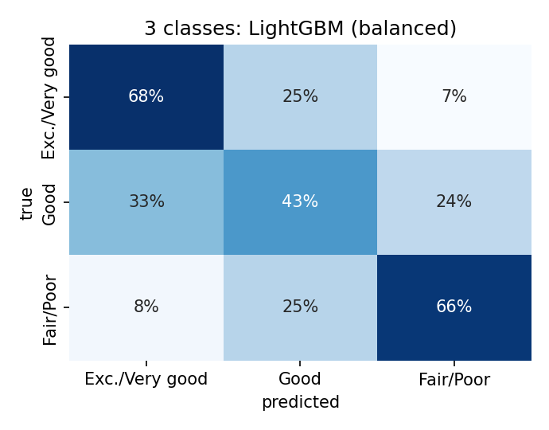

*Figure 15: confusion matrix of LightGBM with class weights (out-of-fold, each row sums to 100 %).*

**Findings.**

- LightGBM is again the best model. Class weights trade a little AUC for a better balance between the
  classes (balanced accuracy 0.565 → 0.593), as in the binary problem.
- **The two extremes are well separated**: only 7–8 % of the Excellent/Very good people are predicted
  Fair/Poor and vice versa.
- **The middle class is the hard one**: only 43 % of the *Good* people are recognised, the rest being
  split between the two neighbours. "Good" is a boundary category, and the step from "very good" to
  "good" depends on personal judgement more than on the measured factors.
- The **original five classes** confirm this (best macro-F1 0.398, macro-AUC 0.768): splitting
  Excellent from Very good and Fair from Poor adds two more boundaries that the data cannot draw well.
- The target is **ordinal**, and the errors show it: in Figure 15, mistakes between adjacent classes
  (24–33 %) are three to four times more frequent than between the two extremes (7–8 %).

## 8. Final model and recommendation

### 8.1 The final model

All the evidence points to the same choice:

| Decision | Choice | Evidence |
|---|---|---|
| Model | **LightGBM** | tied best with the other boosting models (Wilcoxon, Section 6.5), 30× faster |
| Variables | **all 49 original variables** | selection, the hypothesis subset and PCA all lose accuracy (6.3, 6.4); engineered features add nothing for LightGBM (7.2) |
| Imbalance | **no resampling; threshold chosen explicitly** | resampling does not raise AUC (6.2) |
| Hyperparameters | **randomised search, 25 settings, 3-fold CV** | the procedure validated by nested CV (7.1) |

The search was run once more on the whole sample of 50,000 people; it chose a slow learning rate (0.010)
with 760 trees of up to 98 leaves, at least 364 people per leaf, and 57 % of the rows and 73 % of the
columns per tree. The **decision threshold** was chosen from out-of-fold predictions on the same sample,
with Youden's J: **0.155**, close to the share of Fair/Poor people (0.166), as expected for a
well-calibrated model.

### 8.2 Confirmation on 100,000 new people

The model was then applied **once** to the hold-out set, which had not been used for any decision:

| Model | ROC-AUC | PR-AUC | Brier score |
|---|---|---|---|
| **Final: tuned LightGBM** | **0.871** | **0.608** | **0.094** |
| Logistic regression (Section 5) | 0.865 | 0.601 | 0.096 |
| Dummy (prior) | 0.500 | 0.166 | 0.139 |

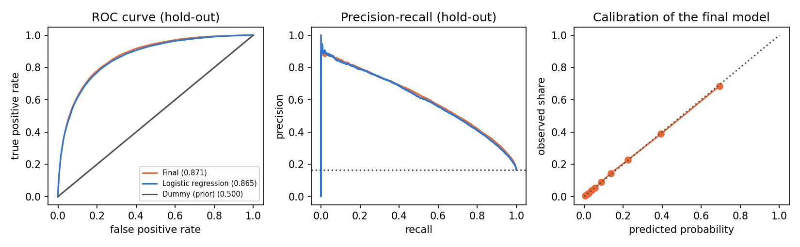

*Figure 16: ROC and precision-recall curves on the hold-out set (dotted: random model), and calibration
of the final model (points on the diagonal = predicted probabilities match the observed shares).*

The hold-out AUC (0.871) is slightly **higher** than in cross-validation (0.866): the final model is
trained on all 50,000 people instead of 45,000, exactly as the learning curve predicted (0.872 at
50,000 rows, Section 4.2). So the cross-validated results were **not optimistic**, and the model
generalises to new people. Its probabilities are also **well calibrated** (Figure 16, right): when it
says 40 %, about 40 % of those people are in fair or poor health.

**At the chosen threshold**, on the hold-out set:

| Sensitivity | Specificity | Precision | F1 | Balanced accuracy |
|---|---|---|---|---|
| 80.5 % | 77.5 % | 41.6 % | 0.548 | 0.790 |

In plain words, for every 1,000 people: 166 are in fair or poor health, and the model **finds 134 of
them** and misses 32; it also flags 188 of the 834 healthy people. Of the people it flags, 42 % really
are in fair or poor health, **2.5 times** the 16.6 % expected by chance.

### 8.3 Recommendation

- **Use the tuned LightGBM model** for screening at population level: it is the most accurate model,
  calibrated, fast to train (seconds) and explainable with SHAP.
- **Choose the threshold for the purpose.** The Youden threshold balances both errors; a programme
  that must not miss anyone should lower it (more sensitivity, more false alarms), and one with limited
  resources should raise it. The calibrated probabilities make this choice easy to reason about.
- **If a simpler model is required**, logistic regression loses only 0.006 AUC and its coefficients
  can be read directly; it benefits from the engineered features of Section 7.2.
- **Do not expect much more from other algorithms.** Ten models, tuning and feature engineering all
  converge on 0.866–0.871. The remaining errors come from information that is not in the data
  (Section 6.6); to go further, new variables would be needed (for example pain, recent illness or
  the excluded *Healthy Days* questions, if the purpose allows them).

## 9. Conclusions

1. **Self-rated health can be predicted well** from causes and circumstances alone: ROC-AUC 0.871 on
   100,000 new people, far above the 0.5 baseline, after removing the six variables that leak the
   answer.
2. **What matters most is function, disease and money**: difficulty walking, physical inactivity,
   chronic conditions and low income or education. The three groups disability, chronic conditions and
   socioeconomic status alone reach 96 % of the full performance with fewer than half of the variables.
3. **The relationship is mostly additive**, so logistic regression is almost as good as the best
   model; gradient boosting gains by capturing non-linear effects such as the U-shaped BMI curve and
   the inverted-U effect of age.
4. **Many standard techniques did not help here** — rebalancing, PCA, feature selection and feature
   engineering for the boosted model — and the statistical tests show it. Knowing *why* (Sections 6.2–6.4)
   is as useful as the final number.
5. **The remaining errors are people whose own judgement differs from their risk profile**: healthy-looking
   people who feel unwell and very ill people who feel fine. Self-rated health is a personal judgement,
   which is exactly why it is valuable in public health.

## 10. Ethics

**Data.** BRFSS is public, anonymised data released by the CDC for research; no attempt was made to
identify anyone, and the raw files are not redistributed in the repository (the script downloads them).

**Limits of the conclusions.**

- **Association, not causation.** The model shows which characteristics go together with poor
  self-rated health. It does not show that changing them would change anyone's health: for example,
  poor health can cause low income (through job loss) as much as low income can cause poor health.
- **Self-reported data.** Both the target and most predictors are answers to a telephone survey, with the
  usual errors of memory and social desirability. The model learns how people *describe* their health.
- **No survey weights.** BRFSS provides weights to make the sample represent the US population; they
  were not used, so the percentages describe the people interviewed, not the whole country.
- **Fairness.** Income, education, race and state are among the predictors. They are useful to describe
  health inequalities, but a model like this must **not** be used to make decisions about individuals
  (insurance prices, access to services, hiring), where it would penalise people for their
  socioeconomic situation. Its intended use is population-level analysis, such as targeting public
  health programmes to the groups that need them most.

## References

1. Centers for Disease Control and Prevention. *Behavioral Risk Factor Surveillance System, 2021 Survey
   Data and Codebook (LLCP 2021)*. <https://www.cdc.gov/brfss/annual_data/annual_2021.html>
2. Centers for Disease Control and Prevention. *Health-Related Quality of Life (HRQOL-4) — Healthy Days
   measures*. <https://www.cdc.gov/hrqol/>
3. Idler, E. L. & Benyamini, Y. (1997). Self-rated health and mortality: a review of twenty-seven
   community studies. *Journal of Health and Social Behavior*, 38(1), 21–37.
4. Pedregosa, F. et al. (2011). Scikit-learn: Machine learning in Python. *JMLR*, 12, 2825–2830.
5. Ke, G. et al. (2017). LightGBM: A highly efficient gradient boosting decision tree. *NeurIPS 30*.
6. Chawla, N. V. et al. (2002). SMOTE: Synthetic minority over-sampling technique. *JAIR*, 16, 321–357.
7. Demšar, J. (2006). Statistical comparisons of classifiers over multiple data sets. *JMLR*, 7, 1–30.
8. Cawley, G. C. & Talbot, N. L. C. (2010). On over-fitting in model selection and subsequent selection
   bias in performance evaluation. *JMLR*, 11, 2079–2107.
9. Lundberg, S. M. & Lee, S.-I. (2017). A unified approach to interpreting model predictions. *NeurIPS 30*.
10. World Health Organization. *Body mass index (BMI) classification*; *Healthy diet* (five portions of
    fruit and vegetables a day).
